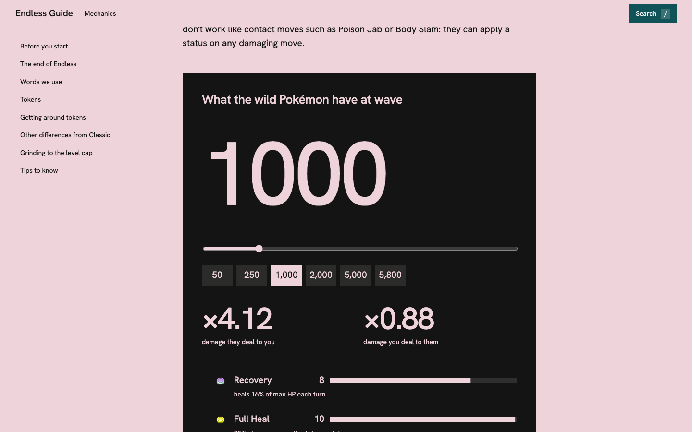

# PokeRogue Endless Guide

**Endless, to 5850.** The PokeRogue community's Endless guide as a website you can search: tokens, fusion, the six team roles, complete builds, run enders and common mistakes, all the way to the final wave.

**Live:** https://zi-cong-tan.github.io/PokeRogue-Endless-Guide/



## Where the guide comes from

Every word of strategy here comes from the **[Community Endless guide](https://docs.google.com/document/d/1vAgiz1xfT3Ul-ZEmP7B4saDt_kX-_mnAIe3pu8kv-rk/edit)** on Google Docs, written by **Monkee** and **Lululalu_a** with input from many of the top Endless players on the PokeRogue Discord: Excoman, Table, Andr, Sang, Grex, Gyaradope, Sandstorm, Steven, Pepo, Aoisme and Squid. The in-game screenshots are theirs too. This site only reorganises the guide so it's easier to find things between waves. For suggestions about the strategy itself, ping `cool_monkee` on Discord.

## What's on the site

- **Seven chapters**, each in its own colour: Mechanics, Fusion, The team, Builds, The run, Run enders, Mistakes.
- **Search** (press `/` or `Ctrl/Cmd + K`) across every section, with a jump straight to it. Every heading is also a link you can share, like `#iron-hands`.
- **Token calculator**: pick a wave and see the tokens wild Pokémon have, how much harder they hit and how little you deal. It uses the game's own token weights, stack sizes and caps (from `pagefaultgames/pokerogue`), averaged over 300 simulated runs. It also shows something the guide only hints at: by wave 5800 every token is maxed, which is why the run ends at 5850.
- Pokémon sprites in every table, and a section list that follows you as you read.

## Run it yourself

```bash
npm install
npm run dev        # local site
npm test           # checks the token maths
npm run tokens 2000   # print the tokens at any wave in your terminal
```

## Fix or add to the guide

The guide lives in plain Markdown, one file per chapter, in [`src/content/`](src/content). To fix a mistake or add something, edit the file and open a pull request.

- `## Heading` starts a section (it shows in the side list and search); `### Heading` starts a smaller one.
- `` shows a Pokémon sprite. Use the PokeAPI name, then run `node scripts/sprites.mjs` to fetch any new sprite.
- `` shows a screenshot from `public/shots/`.
- `{{tokens}}` places the token calculator.

## Built with

React, Vite and GSAP, set in Hanken Grotesk. The token maths is in [`src/tokens.js`](src/tokens.js), shared by the site and the command-line script.

## Licence

The site's code is MIT (see `LICENSE`). The guide's text and screenshots belong to their authors and are used with credit. Pokémon sprites come from PokeAPI (animated ones from Pokémon Showdown); token icons from `pagefaultgames/pokerogue-assets` (CC BY-NC-SA 4.0). Pokémon and PokeRogue belong to their owners; this is a fan project.

Also by Zi: the [PokeRogue Classic Guide](https://zi-cong-tan.github.io/PokeRogue-Classic-Guide/).
